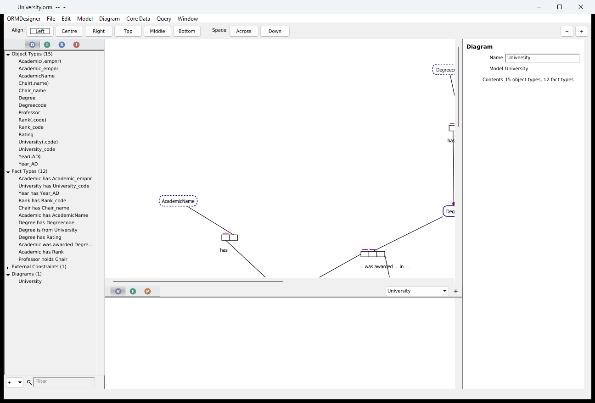
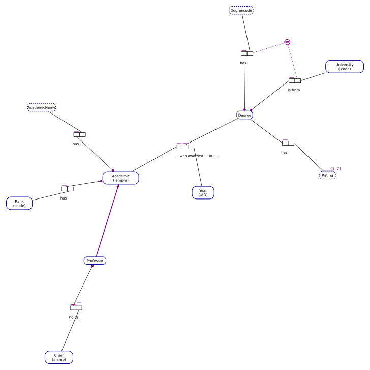
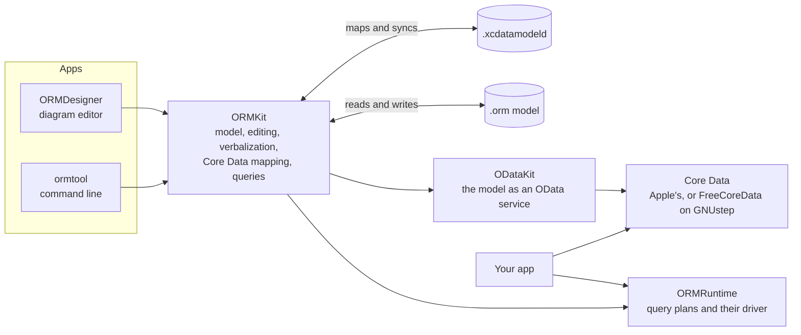

# ORMKit

**Describe your data as facts, in plain sentences, and get a diagram, a
readable specification and a working Core Data model out of the same
description, kept in step as either side changes.**

ORMKit is an Object-Role Modeling (ORM2) toolkit for macOS, Linux and
Windows, written in Objective-C. Instead of starting from tables or classes,
you state what is true about your domain: *an Academic has a Rank*, *an
Academic was awarded a Degree in a Year*, *each Degree has at most one
Rating*. ORMKit keeps those facts and their rules as one model, and from it:

- **draws it** as an ORM diagram you edit directly in ORMDesigner;
- **reads it back to you in English**, so a domain expert can check the rules
  without learning a notation;
- **writes a Core Data model** (`.xcdatamodeld`) for your app, and brings
  changes made in Xcode back into the model;
- **runs queries** against sample data, and serves the model over OData;
- does all of it **from the command line** too, with `ormtool`, for builds
  and scripts.



The University sample, as ORMDesigner and `ormtool svg` draw it:



and part of what ORMKit says about it (`ormtool verbalize Samples/University.orm`):

> Each Professor is an Academic.
>
> For each Academic and Degree, that Academic was awarded that Degree in at most one Year.
>
> For each Degreecode and University, at most one Degree has that Degreecode and is from that University.
>
> Each Degree has at most one Rating.

## What is in the box

- **ORMKit**: the library. Foundation and NSXML only, no AppKit, ARC; it
  builds on Cocoa and on GNUstep.
- **ORMDesigner**: a document-based diagram editor for `.orm` models.
- **ormtool**: the library from a shell.
- **ORMRuntime**: what an app built from a model runs: its query plans and a
  small driver, with no ORM model and no XML.



[docs/ARCHITECTURE.md](docs/ARCHITECTURE.md) has the details.

## Download

Each [release](https://github.com/ashalkhakov/ORMKit/releases) has:

- **macOS**: ORMDesigner, signed and notarized, updating itself with Sparkle;
- **Linux**: an AppImage with ORMDesigner and `ormtool`
  (`./ORMKit-*.AppImage ormtool check model.orm`);
- **Windows**: an installer, `ORMDesigner-<version>-win64.msi`, with
  `ormtool` in its runtime, updating itself with WinSparkle.

LGPL 2.1.

## Works with NORMA

ORMKit's models are `.orm` files in the format of
[NORMA](https://github.com/ormsolutions/NORMA), the ORM2 tool for Visual
Studio, so models move freely between the two.

ORMDesigner opens what NORMA saves and saves what NORMA opens. The XML
document is the model: an edit changes what it touches and nothing else, so
NORMA's own data (relational bridges, join paths, extension data) goes back
with the file, and an unchanged file is written back byte for byte. What NORMA
derives and stores beside the model (played roles, internal constraint lists,
`_IsMandatory`, `_Multiplicity`, reading expansions, implied mandatory
constraints) is kept up after each edit by NORMA's own rules, checked against
files NORMA wrote.

## Editing

- Object types: entity and value types, reference modes (`.id`, `kg:`),
  data types, value constraints, independence.
- Fact types of any arity, unaries included, typed as NORMA's Fact Editor
  takes them: `Person(.id) was born in Country(.code)`; readings in either
  direction, hyphen binding (`includes first- StreetLine`).
- Constraints: internal and external uniqueness, preferred identifiers,
  mandatory and inclusive-or, exclusion and exclusive-or, subset, equality,
  frequency, ring, value comparison; alethic or deontic.
- Subtyping, objectification, model notes, any number of diagrams.
- Every change undoable.

## Verbalization

The selection is read out as NORMA's verbalization browser reads it:

> Each Product is identified by exactly one SKU.
> For each SKU, at most one Product is identified by that SKU.
> For each StreetLine1, StreetLine2 and StreetLine3, at most one Street includes that first StreetLine1 and includes that second StreetLine2 and includes that third StreetLine3.
> No ItemCategory may cycle back to itself via one or more traversals through ItemCategory is child of ItemCategory.

The whole model exports as HTML.

## Core Data

A model maps to one or more Core Data models (`.xcdatamodeld`): entity types to
entities, functional fact types to attributes and to-one relationships,
many-to-many fact types to to-many relationships, unaries to Booleans, longer
and objectified fact types to entities of their own, subtyping to entity
inheritance, identifiers and composite identifiers to uniqueness
constraints; what Core Data cannot enforce is reported and kept with the
entity. Synchronizing is a three-way merge: what changed in the ORM model is
written out, and what changed in Xcode comes back as the ORM change that
would have made it. See [docs/COREDATA-MAPPING.md](docs/COREDATA-MAPPING.md).

## Building

ORMKit links [ODataKit](https://github.com/ashalkhakov/ODataKit) ([docs/ODATA.md](docs/ODATA.md)),
and on GNUstep [FreeCoreData](https://github.com/ashalkhakov/FreeCoreData) under it;
`.github/pins.env` names the exact releases it builds on, with the GNUstep
stack and Sparkle (ORMDesigner's updates on macOS).

macOS, with ODataKit's XCFrameworks and Sparkle's in `.deps/`
(gnustep-release-actions' `scripts/deps.sh apple` fetches them by those
versions):

```sh
make -f Makefile.apple && make -f Makefile.apple check
make -f Makefile.apple install DESTDIR=out
```

or open `ORMKit.xcworkspace` (`python3 .tools/genxcodeproj.py` writes it).

GNUstep (clang, libobjc2, gnustep-2.0 runtime, tools-xctest), with those
releases installed (`scripts/deps.sh linux` unpacks them into `/opt/gnustep`):

```sh
. /path/to/GNUstep.sh
make && make check && make install
```

or in docker, in an image that has them: `.tools/gnustep.sh make check`.

One workflow, `.github/workflows/build.yml`, runs the same on every push and
`v*` tag, by gnustep-release-actions' workflows (the same as every
repository's), on macOS, Linux and Windows (MSYS2 CLANG64), and packages
what was installed: ORMDesigner for macOS, an AppImage with ORMDesigner and
`ormtool` (`./ORMKit-*.AppImage ormtool check model.orm`), and a Windows
installer with both. A tag releases them: ORMDesigner signed and notarized
with the Sparkle appcast its Check for Updates… reads, the AppImage with its
update information, the installer with its WinSparkle appcast.

## ormtool

```sh
ormtool check model.orm
ormtool verbalize [--html] model.orm
ormtool normalize model.orm out.orm
ormtool coredata model.orm Out.xcdatamodeld [mapping name] [--validation dir/]
ormtool svg [--dark] model.orm [out.svg | dir/] [diagram name]
ormtool import Model.xcdatamodeld [model.orm]
ormtool validation model.orm dir/ [mapping name]
ormtool query model.orm [query name] [mapping name]
ormtool forml model.orm [out.forml]
ormtool apply model.orm changes.forml [out.orm]
ormtool build schema.forml model.orm
```

`forml` writes the model as schema text: every statement, a line each as the
verbalizer says it, by diagram, each element's note as a comment before it,
each query as its outline. It is a listing, generated (a build makes it
beside what else it generates); the model is the `.orm`.
`apply` changes the model with lines of that text, as one change written
back only when every line is read: what the model lacks is made, what it
says already left, a comment before a line set as the note of what it says,
and a line starting `- ` taken away (a fact type, a constraint, a
derivation, a fact of reference data, a note, `- Query Name:` a query); a
query given again under its name replaces it. ORMDesigner is the other way
to change a model. `build` makes a new model from such text, with each line
it cannot read, and why, on standard error: how a model begins, not how it
changes ([docs/MODEL.md](docs/MODEL.md#the-model-as-text)).
`coredata --validation dir/` writes the validation code there rather than
where the mapping keeps it: what a build that generates from the model asks.

`svg` draws a diagram as the editor does: the first (or the named one) to
standard output or a file, or every diagram into a directory, a file each.
`import` brings a Core Data model into ORM: into the `.orm` when it exists,
else into a new model, with what ORM cannot say on standard error.
`validation` writes code that checks the constraints Core Data cannot enforce:
a category on each entity's class, called from its `validateForInsert:` and
`validateForUpdate:`. `query` prints a conceptual query ([docs/QUERIES.md](docs/QUERIES.md)) as
ConQuer's outline, in FORML, as a request to the OData service ODataKit makes
of the mapping, as its plan with the fetches that run it, and as the rows it
finds in the model's sample population.

[Samples/](Samples/README.md) has models to start from: the schemas of
Halpin's papers on conceptual queries and on UML and ORM, with the papers'
queries. Queries run on a model's sample population, kept in the `.orm` as
NORMA keeps it, or made up to meet the constraints
([docs/POPULATIONS.md](docs/POPULATIONS.md)).

## License

LGPL 2.1 (`LICENSE`). The test fixtures in `ORMKitTests/Fixtures/ActiveFacts`
are Clifford Heath's ActiveFacts examples, under the MIT license
(`ORMKitTests/Fixtures/ActiveFacts/LICENSE.txt`); those in
`ORMKitTests/Fixtures/NORMA` are NORMA's sample and test models, under the
Common Public License 1.0 (`ORMKitTests/Fixtures/NORMA/LICENSE.txt`). Neither
is part of the library. The models in `Samples/` are ORMKit's own, of
schemas Halpin's papers publish; StockMate, which ORMDesigner also bundles,
is its author's, used with their leave. ORMDesigner's tab bars are Daniele
Margutti's DMTabBar, under the MIT license
(`ORMDesigner/ThirdParty/DMTabBar/LICENSE-DMTabBar.txt`, also in the app).
